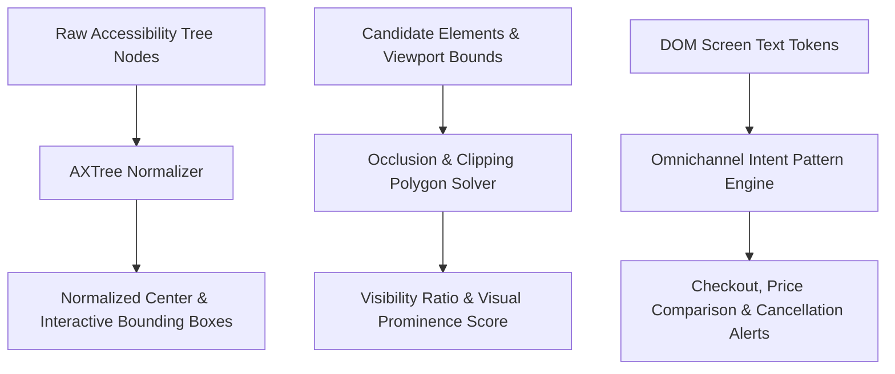

# genpark-screen-context


GenPark Screen Context is a zero-dependency autonomous UI agent perception engine implementing Accessibility Tree (AXTree) coordinate bounding box normalization, viewport occlusion and clipping polygon analysis, and real-time omnichannel e-commerce intent trigger detection.



## Features
- **AXTree Coordinate Normalizer**: Maps arbitrary screen resolutions to unit $[0, 1]$ bounding box vectors and interactive element classifications.
- **Viewport Occlusion Solver**: Computes geometric intersection, offscreen detection, and center-weighted visual prominence scores.
- **Omnichannel Intent Matcher**: Detects purchase, price comparison, and churn risk triggers from DOM token streams.

## Quickstart

```python
from client import GenParkScreenContext

sc = GenParkScreenContext()
res = sc.match_omnichannel_intent_trigger(["checkout", "order", "total"])
print("Intent:", res["primary_intent"])
```

## License
MIT
